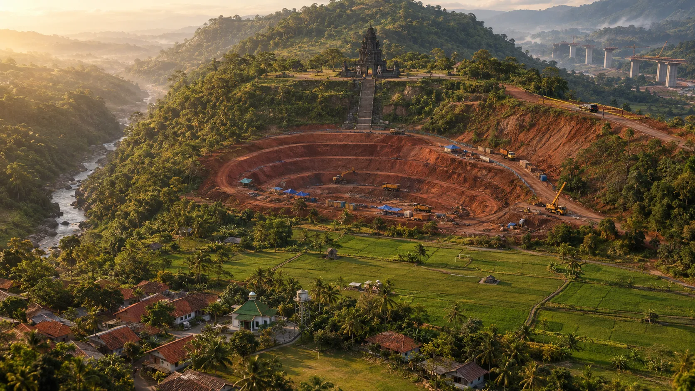
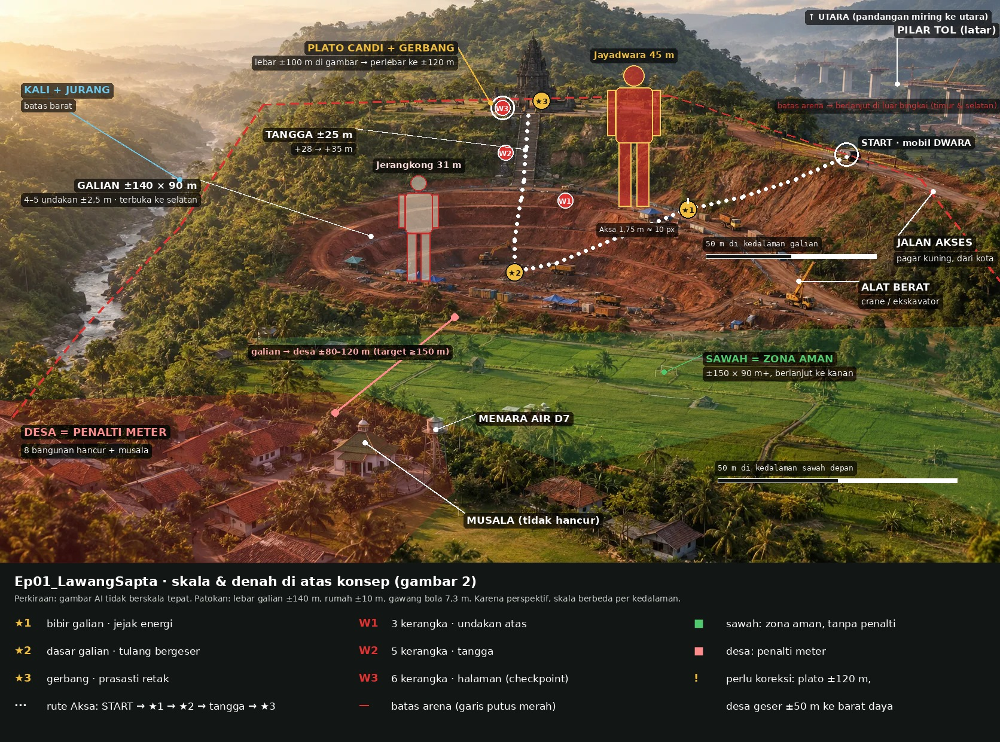

# 30 — Desain Level Ep 1: `Ep01_LawangSapta`

> **Status: DISETUJUI v0.2 (15 Okt 2026)**: keputusan E1–E7 dijawab developer (semua sesuai usulan, bagian 9). Blockout 3D Blender didokumentasikan dulu, eksekusi nanti (bagian 10). Rincian dari pola di [28](28-struktur-level-episode.md#ep-1--ep01_lawangsapta--sore--senja-merah--awal-malam).
> Sumber: [17](17-skenario-arc-1.md#episode-1--gerbang-yang-retak) (adegan), [18](18-kebutuhan-episode-1.md#c-lingkungan--level) (zona & aset), [11](11-vertical-slice-spec.md) (scope), [23](23-rencana-fase-1.md) (angka combat & level uji). Kalau bertentangan, dokumen sumber yang berlaku.

**Visual:** denah berlapis, potongan bukit berskala, perbandingan tinggi, dan linimasa cahaya ada di [`visual/ep01-lawang-sapta.html`](visual/ep01-lawang-sapta.html) (buka di browser).

**Konsep realistis (acuan tata letak, 15 Okt 2026):** gambar AI dari developer, dipilih dari tiga variasi sebagai acuan suasana dan tata letak (desa di barat daya dekat kali, sawah di selatan–tenggara, galian terbuka ke selatan). Anotasi skala, zona, rute, dan siluet berskala dibuat Claude di atasnya. Angka di anotasi adalah perkiraan; yang mengikat tetap tabel koordinat bagian 2.





Koreksi terhadap gambar konsep saat greybox: plato diperlebar dari ±100 m ke ±120 m; desa digeser ±50 m ke barat daya supaya jaraknya ≥150 m dari bibir galian; candi sedikit lebih kecil dari yang tergambar.

**Posisi di roadmap:** greybox di akhir Fase 1 (setelah Iterasi 7–8 memberi angka arena dan FPS), level art di Fase 2 (Jun–Jul 2027, [10](10-roadmap.md#fase-2--vertical-slice-episode-1-gerbang-yang-retak-apr--des-2027)). Semua angka di dokumen ini **titik awal greybox**, bukan final.

---

## 1. Ringkasan

| | |
|---|---|
| **Konsep tempat** | Bukit candi kuno yang sedang digali untuk **proyek jalan tol Adikara** ([17 adegan 2](17-skenario-arc-1.md#adegan-2--briefing-di-jalan--dialog)). Candi di puncak, galian di lereng, desa di kaki bukit |
| **Gaya** | Realistis ([README](README.md#ringkasan-keputusan-yang-sudah-final)): candi batu andesit berlumut, tanah merah galian, desa Jawa sederhana |
| **Durasi main** | ±20–25 menit (tanpa pembuka wayang dan dialog) |
| **Area total** | ±800 × 800 m bisa diinjak raksasa; latar jauh di luar itu |
| **Skala acuan** | Aksa 1,75 m · kerangka minion ±1,9 m · Jerangkong ±31 m · Jayadwara ±45 m |
| **Ide utama level** | **Satu bukit, dua skala.** Jalur yang dilalui Aksa selama ±15 menit (galian, tangga candi, halaman) menjadi panggung raksasa yang terlihat kecil dari ketinggian 45 m |

---

## 2. Denah (tampak atas)

Utara = arah candi. Angka = ketinggian tanah relatif terhadap desa (m).

```
                         U
        ┌──────────── hutan lebat + bukit lebih tinggi (batas) ─────────────┐
        │                                                                    │
        │                 ┌──────── PLATO CANDI (+35) ────────┐              │
        │                 │   [candi induk ±20 m]              │              │
 jurang │                 │   halaman (arena atas)             │══ jalan      │
 + kali │                 │   ▣ gerbang + 2 arca + prasasti ★3 │   proyek ══╗ │
 (batas)│                 └────────────┬───────────────────────┘   (truk)   ║ │
        │                    tangga candi (+28 → +35)                       ║ │
        │                 ┌────────────┴───────────────┐                    ║ │
        │                 │   GALIAN BERUNDAK           │                    ║ │
        │                 │   bibir galian (+25) ★1     │  ⌂ pos mandor      ║ │
        │                 │   4 undakan × 2,5 m         │  ▲ alat berat     ║ │
        │                 │   dasar galian (+15) ★2     │                    ║ │
        │                 │   (titik bangkit Jerangkong)│      ● garis polisi║ │
        │                 └────────────┬───────────────┘        mobil DWARA ║ │
        │       kebun / lereng       lereng (+25 → +5)    ◇ batu latihan    ║ │
        │       (penyangga ≥150 m)          │              ═══ JALAN AKSES ═╝ │
        │ ┌─ DESA (+0) ──────────┐  ┌──── SAWAH (+0 … +3) ───────────────┐      │
        │ │ ⌂⌂ rumah ×4 ▤ warung×2│  │ pematang, gubuk, saluran air,      │      │
        │ │ ┃ menara air ⌑ gardu  │  │ lapangan bola                      │      │
        │ │ ☪ musala + lapangan   │  │ ZONA AMAN                          │      │
        │ └──────────────────────┘  └────────────────────────────────────┘      │
        └──────── sawah melebar → kota kecil di kejauhan (latar jauh) ──────────┘
                                         S
```

### Koordinat greybox (meter, titik nol = tengah dasar galian)

| Bagian | Pusat (X, Y) | Ukuran | Tinggi tanah | Catatan |
|---|---|---|---|---|
| Plato candi | (0, +170) | 120 × 100 | +35 | Datar; halaman ±60 × 50 di depan candi induk |
| Candi induk | (0, +195) | alas 18 × 18, tinggi ±20 | +35 | Lebih pendek dari Jerangkong (31 m), sengaja |
| Gerbang + arca | (0, +125) | gerbang lebar 8, arca ±4 m di alas 1 m | +35 | Prasasti di antara dua alas |
| Tangga candi | (0, +100) | lebar 10, panjang 25 | +28 → +35 | Satu-satunya jalan manusia ke plato dari galian |
| Galian | (0, 0) | ±140 × 120 | bibir +25, dasar +15 | 4 undakan × 2,5 m dengan ram di sisi timur; **berbentuk tapal kuda, terbuka ke selatan** (konsep), bentuk tidak beraturan |
| Dasar galian | (0, 0) | diameter ±50 | +15 | Titik bangkit Jerangkong |
| Garis polisi + mobil DWARA | (+140, −20) | — | +25 | Titik mulai pemain |
| Jalan akses | dari (+400, −40) ke (+140, −20) | lebar 7 | +25 | Mengikuti punggung bukit dari timur |
| Jalan proyek | dari (+60, +150) ke (+170, −10) | lebar 8 | +35 → +25 | Truk derek parkir di ujung plato, keluar lewat sini di adegan 6 |
| Batu latihan | (+110, −60) | — | +24 | Menghadap sawah dan desa (interaksi opsional) |
| Kebun / lereng penyangga | (−110, −120) | — | +20 → +2 | Pemisah galian–desa; jarak bibir galian → rumah terdekat **≥150 m** |
| Sawah | (+60, −190) | ±300 × 160 | +0 … +3 | Selatan–tenggara galian; zona aman; ada lapangan bola (konsep) |
| Desa | (−170, −260) | ±180 × 130 | 0 | **Barat daya, dekat kali** (konsep, 15 Okt 2026); 8 bangunan hancur + musala |

Kemiringan lereng plato → sawah: ±35 m turun dalam ±300 m, **±7°**. Untuk Aksa ini bukit; untuk Jayadwara hampir datar. Undakan galian 2,5 m: tinggi bagi Aksa (pakai ram/tangga kayu), setinggi mata kaki bagi Jayadwara.

---

## 3. Zona dan alur pemain

Urutan mengikuti adegan [17](17-skenario-arc-1.md#alur-adegan). Waktu = target main, tanpa dialog panjang.

### A. Kedatangan · adegan 3 · ±2 menit · sore (±16.30)
- **Mulai:** Aksa turun dari mobil DWARA di garis polisi. Tutorial gerak (jalan, lari, lompat, dodge) memakai tumpukan pipa, parit kecil, dan gundukan tanah di jalur ±80 m menuju bibir galian.
- **Landmark:** gerbang candi terlihat di puncak bukit sejak detik pertama, membingkai tujuan ("Masih sama aja"). Desa terlihat di kanan bawah.
- **Mandor** berjalan melawan arah pemain ke jalan akses; truk dan alat berat lain sedang pergi.
- **Opsional:** batu latihan kuda-kuda di pinggir jalur yang menghadap desa ([17 adegan 3](17-skenario-arc-1.md#adegan-3--tiba-di-galian--main--koms)).
- **Batas:** jalan akses ke timur ditutup truk yang parkir melintang dan garis polisi.

### B. Galian · adegan 4 · ±5–6 menit
Di Ep 1 ketiga petunjuk ada di jalur utama ([17 S6](17-skenario-arc-1.md#keputusan-untuk-developer-ep-1)). Jalurnya membentuk huruf **U**: turun ke dasar galian, lalu naik ke candi.

| # | Petunjuk | Lokasi | Cara jalur mengarahkan |
|---|---|---|---|
| ★1 | Jejak energi (`Clue.Ep01.JejakEnergi`) | Bibir galian (+25) | Pertama kali mode scan dipakai: aliran merah mengalir dari dasar galian, naik ke arah gerbang. Pemain melihat seluruh rute sekaligus |
| ★2 | Tulang bergeser (`Clue.Ep01.Tulang`) | Dasar galian (+15) | Ram sisi timur turun 4 undakan. Scan dua kali di titik yang sama (tulang pindah 3 cm). Tidak ada jasad pekerja ([17 S5](17-skenario-arc-1.md#keputusan-untuk-developer-ep-1)) |
| ★3 | Prasasti retak (`Clue.Ep01.Prasasti`) | Gerbang candi (+35) | Naik ram sisi utara → tangga candi. Arca kanan dililit tali derek dari truk di ujung jalan proyek |

- **Isi galian:** patok survei, terpal, tenda kerja, lampu sorot proyek (belum menyala), ember dan cangkul, papan "Proyek Tol Adikara".
- **Ruang combat disiapkan sejak awal:** undakan atas dan halaman candi sengaja lapang. Pemain melewatinya saat tenang sebelum dipakai untuk bertarung.

### C. Konfrontasi · adegan 5 · ±4–6 menit · cahaya mulai merah
Setelah prasasti dibaca, tanah bergetar. Bagas memerintahkan mundur ke mobil, tapi **mobil ada di balik galian** ([17 adegan 5](17-skenario-arc-1.md#adegan-5--tulang-yang-bangun--main-combat-tutorial)). Pemain mencoba turun dan **terdesak kembali naik**:

| Gelombang | Tempat | Musuh | Arah |
|---|---|---|---|
| 1 | Undakan atas galian (+22 … +25) | 3 kerangka keluar dari tanah undakan | Pemain turun dari tangga candi, dihadang |
| 2 | Tangga candi (+28 … +35) | 5 kerangka naik dari galian | Pemain didesak naik; tangga sempit memaksa dodge/tangkis |
| 3 | Halaman depan gerbang (+35) | 6 kerangka yang bangkit lagi | Terpojok di depan arca; finisher pecahkan kepala. **Checkpoint** |

- **Gerbang cerita:** tidak ada jalan kembali ke mobil. Pagar seng proyek dan tenda roboh menutup jalan pintas ke timur.
- **Spawn:** kerangka **merangkak keluar dari tanah** di titik yang ditandai (`AJDWaveSpawner`), bukan muncul tiba-tiba.

### D. Kebangkitan · adegan 6 · ±1,5–2 menit (sequence)
- Senja merah. Tulang di galian tersedot ke dasar galian; Jerangkong bangkit dari **dasar galian (+15)**, kepalanya ±46 m, setinggi gerbang candi plus satu tubuhnya.
- Aksa terpental ke arca kiri di gerbang.
- **Wide shot dari gerbang ke timur:** Jerangkong di tengah, dan di belakangnya truk derek membawa arca kanan berterpal keluar lewat **jalan proyek**. Jalan proyek dirancang agar terlihat jelas di garis pandang ini.
- Transformasi di alas arca kiri. Jayadwara berdiri di plato (+35) dan menahan kaki Jerangkong.

### E. Arena raksasa · adegan 7 · ±6–8 menit · awal malam
Arena = **plato + galian + lereng + sawah + desa**, ±530 × 550 m (desa di barat daya, sawah di selatan–tenggara).

| Bagian arena | Fungsi | Meter sinkronisasi |
|---|---|---|
| Plato & halaman candi | Pembuka fase 1; Jayadwara mulai di sini | Candi **tidak hancur** dan tanpa penalti (bangunan terlalu kokoh; hemat Chaos) |
| Galian | Pusat fase 1: Jerangkong menyusun ulang dari tulang di dasar galian | Tanpa penalti; alat berat dan tenda proyek bisa terlempar (fisika biasa) |
| Lereng & sawah | Ruang transisi; **zona aman** untuk bertarung | Tanpa penalti, hanya kawah tanah |
| Desa | Fase 2: Jerangkong mendekat dan melempar puing ke desa | **Penalti**: gedung hancur dan warga terkena |

- **Fase 1** (galian + plato): sapuan, hantaman, lemparan tulang; lengan/kaki rontok merayap balik ke dasar galian. Setelah susun ulang ke-2 → fase 2.
- **Fase 2** (lereng → desa di barat daya): Jerangkong lebih agresif dan bergerak turun ke arah desa; tengkorak ditandai HUD (prasasti). Puing yang dilempar ke desa bisa **ditangkis**.
- **Pilihan pemain:** galian terbuka ke selatan, jadi dari mulut galian ada dua arah yang jelas: **kiri ke desa** (penalti) atau **kanan ke sawah** (aman). Pemain mendorong Jerangkong ke sawah (butuh dorongan/serangan berat) atau membiarkannya turun ke desa (cepat, tapi meter berisiko). Ini pelajaran meter pertama tanpa perlu dijelaskan panjang.
- **Kalah sebagai Jayadwara** ([23 bagian 4.5](23-rencana-fase-1.md#45-kalah-sebagai-jayadwara--energi-transformasi-q15)): Aksa muncul di tempat dan harus menghindar sampai energi transformasi penuh. Karena itu sawah dan lereng diberi **perlindungan skala manusia** (gubuk, pematang, saluran air, batu besar) supaya Aksa bisa bersembunyi dari injakan dan puing.
- **Checkpoint:** awal fase 1, awal fase 2.

### Penyegelan & debrief · adegan 8–9
- Penyegelan di tempat boss kalah (sequence fleksibel; `LS_Ep01_Penyegelan` memakai posisi boss).
- **Debrief di plato candi** (malam, lampu sorot proyek menyala): Aksa duduk di **alas arca kiri yang kosong**, dan kamera menyorot alas arca kanan (bekas tali derek + jejak ban truk ke jalan proyek).

---

## 4. Daftar bangunan dan prop arena

### Bangunan yang bisa hancur (desa) — 8 + 2 cadangan
| ID | Bangunan | Ukuran kasar (P × L × T) | Catatan |
|---|---|---|---|
| D1–D4 | Rumah bata genteng | 10 × 8 × 6 m | Dari 1 mesh dasar + 2 variasi atap ([18](18-kebutuhan-episode-1.md#c-lingkungan--level): 3–4 mesh dasar → 6–10 varian) |
| D5–D6 | Warung kayu/seng | 6 × 5 × 4 m | Paling mudah runtuh; banyak puing ringan |
| D7 | Menara air besi | 4 × 4 × 15 m | Tinggi, terbaca dari kamera raksasa; roboh = air tumpah (VFX) |
| D8 | Gardu ronda + kentongan | 3 × 3 × 4 m | Kecil; untuk "kecelakaan" yang tidak sengaja |
| D9–D10 | *(cadangan)* rumah tambahan | — | Dipakai kalau uji FPS di Iterasi 7 lulus untuk 10 gedung |

### Tidak bisa hancur
- **Musala desa** (aturan budaya, [17 cek IP](17-skenario-arc-1.md#cek-ip--budaya-ep-1)).
- **Candi induk, gerbang, alas arca** (cagar budaya + lore; sequence membutuhkan bentuknya utuh).
- **Tiang listrik dan kabel desa:** dekorasi pembanding skala, tanpa fisika (hemat).

### Warga
- **8–12 warga** (`AJDCivilianMarker`, [23 Iterasi 7](23-rencana-fase-1.md#iterasi-7--gedung-hancur--meter-sinkronisasi)) di desa saat fase 2 dimulai, berlari ke **lapangan desa** di sebelah musala.
- Warga yang sampai lapangan = aman. Tanpa Mass AI ([11](11-vertical-slice-spec.md#di-luar-scope-jangan-dikerjakan-di-fase-ini)).

### Prop proyek Adikara (dipakai ulang di Arc 2)
Pagar seng, ekskavator, buldoser, truk derek, kantor kontainer (pos mandor), lampu sorot proyek, papan proyek tol, patok survei, terpal, tenda kerja.

---

## 5. Suasana dan pencahayaan

| Adegan | Waktu | Cahaya | Catatan |
|---|---|---|---|
| 3–4 | ±16.30 | Matahari rendah dari barat (di belakang desa), bayangan panjang ke arah candi | Hangat, tenang; tanah merah galian menonjol |
| 5 | ±17.30 | Cahaya mulai jingga, kabut tipis di lembah | Ketegangan naik |
| 6 | Senja | **Langit merah** (sesuai skenario), energi Kala merah di galian | Puncak sinematik |
| 7 | Awal malam | Sisa merah di barat + lampu desa + glow energi Kala Jerangkong + emas Jayadwara | Siluet dua raksasa terbaca di langit gelap |
| 8–9 | Malam | Lampu sorot proyek dan DWARA | Debrief |

- Transisi waktu memakai **Data Layer pencahayaan** (`DL_Pra`, `DL_Boss`, `DL_Pasca`, [28](28-struktur-level-episode.md#teknis-per-map)) yang diganti saat sequence, bukan siklus waktu real-time.
- **Kabut lembah** antara bukit dan desa menambah rasa jarak dan menyembunyikan latar jauh yang murah.

---

## 6. Latar jauh dan batas

| Arah | Batas yang terlihat | Fungsi |
|---|---|---|
| Utara | Hutan lebat dan bukit lebih tinggi di belakang candi | Menutup arena; bukit lebih tinggi dari Jayadwara memberi skala |
| Barat | Jurang dan kali | Batas alami; cahaya matahari sore |
| Timur | Punggung bukit + jalan akses + **pilar tol setengah jadi** di kejauhan | Cerita Adikara; pembanding skala |
| Selatan | Desa (barat daya) dan sawah (tenggara) melebar → kota kecil di kejauhan | Rasa "ini dekat dengan kehidupan biasa" |

- Pemain dibatasi `BlockingVolume` di balik batas alami. Jatuh ke jurang → respawn di titik terdekat.
- Latar jauh = mesh murah / HLOD / kartu matte; tidak bisa didatangi.

---

## 7. Anggaran performa (titik awal)

Target 60 FPS di 1080p PC menengah ([12](12-technical-design.md#target-performa)).

| Item | Batas awal | Diuji di |
|---|---|---|
| Gedung hancur aktif | 8 (maks 10) | Iterasi 7 `Test_Destruction` |
| Puing | Dibersihkan bertahap ([12](12-technical-design.md)) | Iterasi 7 |
| Warga | ≤ 12 | Iterasi 7 |
| Minion bersamaan | ≤ 6 (gelombang 3) | Iterasi 5 |
| Candi, batu, tanah | Nanite | Fase 2 |
| Vegetasi | Kepadatan rendah di arena (raksasa melihat jauh), padat hanya di batas | Fase 2 |
| Lumen | Preset rendah disiapkan sejak greybox | Greybox |

---

## 8. Greybox (akhir Fase 1)

Greybox dibuat dengan skrip Python (`Tools/ue_greybox_ep01.py`, belum dibuat) supaya angka bagian 2 bisa diubah dan dijalankan ulang:
1. Medan: plato, tangga, galian 4 undakan + ram, lereng, sawah, desa (kotak dan bidang miring).
2. Kotak candi induk, gerbang, alas arca, prasasti; kotak gedung D1–D10 + musala.
3. Titik mulai, `AJDWaveSpawner` gelombang 1–3, checkpoint, titik bangkit boss, titik transformasi, lapangan desa.
4. Penanda petunjuk ★1–★3 (sementara memakai trigger kotak sampai scanner Netra ada di Fase 2).
5. `BlockingVolume` batas dan latar kotak untuk uji garis pandang (gerbang terlihat dari garis polisi; truk terlihat dari gerbang).

**Diuji di greybox:** waktu tempuh zona A–C, terbaca-tidaknya landmark, ukuran arena untuk raksasa 45 m, sudut kamera raksasa saat di lereng, dan FPS dengan 8–10 gedung.

---

## 9. Keputusan (dijawab developer 15 Okt 2026)

Semua keputusan disetujui sesuai usulan Claude.

| # | Pertanyaan | Keputusan ✅ |
|---|---|---|
| **E1** | Tata letak bukit: candi di puncak, galian di lereng, desa di kaki bukit, jalan dari timur? | **Ya**, sesuai adegan 3 dan 6 |
| **E2** | Arah gelombang: pemain terdesak **naik** dari galian ke halaman candi? | **Ya**. Cocok dengan dialog "mobilnya di belakang mereka" dan berakhir di arca untuk adegan 6 |
| **E3** | Sawah sebagai zona aman (tanpa penalti meter)? | **Ya**. Memberi pilihan dan mengajarkan meter tanpa teks panjang |
| **E4** | Candi tidak bisa hancur dan tanpa penalti? | **Ya** (lore + hemat). Alternatif: penalti kecil kalau terkena |
| **E5** | Jalan proyek terpisah untuk truk derek (terlihat dari gerbang)? | **Ya**, supaya wide shot adegan 6 terbaca |
| **E6** | Pilar tol setengah jadi di latar: hanya latar, atau bisa dihancurkan tanpa penalti? | **Latar saja** di vertical slice; versi bisa hancur → backlog |
| **E7** | Jumlah gedung hancur 8 atau 10? | **8**, naik ke 10 kalau uji FPS Iterasi 7 lulus |

---

## 10. Rencana blockout 3D di Blender (didokumentasikan 15 Okt 2026, eksekusi nanti)

Tujuan: melihat bukit, galian, candi, dan desa dalam 3D **sebelum** greybox UE, terutama rasa skala dan garis pandang. Developer memilih "dokumentasi dulu, eksekusi nanti", dengan opsi teknis diserahkan ke Claude. Pilihan Claude:

### 10.1 Satu sumber data untuk Blender dan UE
- **`Art/Level/ep01_layout.json`** menjadi sumber kebenaran tata letak: medan (profil ketinggian bagian 2), semua objek dengan posisi/ukuran/rotasi dari tabel koordinat, titik gameplay (START, ★1–★3, W1–W3, checkpoint, titik bangkit boss, titik transformasi, lapangan), dan kamera.
- Skrip Blender dan skrip greybox UE (`Tools/ue_greybox_ep01.py`, bagian 8) **sama-sama membaca file ini**, jadi tata letak cukup diubah di satu tempat dan kedua alat tidak pernah berbeda.
- Satuan: meter di JSON; Blender 1 unit = 1 m; UE dikali 100 (cm). Sumbu: X timur, Y utara, Z atas, titik nol tengah dasar galian (sama dengan bagian 2).

### 10.2 Skrip dan file
| File | Isi |
|---|---|
| `Art/Level/ep01_layout.json` | Data tata letak (10.1) |
| `Art/Scripts/lv_ep01_blockout.py` | Membangun scene dari JSON; bisa lewat MCP Blender atau headless (`blender --background --factory-startup --python ...`) |
| `Art/Blender/level/ep01_blockout_v01.blend` | Hasil scene (LFS) |
| `docs/visual/ep01_blockout_C1.png` … `C6.png` | Render kamera (LFS), ditautkan dari dokumen ini |

### 10.3 Isi scene
- **Medan:** grid ±800 × 800 m (sel 5 m) yang ditinggikan mengikuti profil bagian 2; galian dibuat sebagai 4 undakan tegas (2,5 m) dan dasar datar; tangga sebagai anak tangga kotak.
- **Bangunan kotak** dengan ukuran tabel bagian 4: candi induk (bentuk bertingkat sederhana), gerbang, alas + arca, rumah D1–D4, warung D5–D6, menara air D7, gardu D8, cadangan D9–D10 (wireframe), musala, pos mandor, alat berat, truk derek.
- **Figur berskala:** pakai model asli dari `Art/Export/` (`SK_Aksa2`, `SK_Jayadwara2`, Jerangkong) di posisi adegan; kalau gagal impor, kapsul dengan tinggi yang sama (1,75 / 31 / 45 m).
- **Penanda gameplay:** bola warna untuk ★, W, checkpoint; garis putus untuk jalur Aksa dan garis pandang (warna sama dengan [visual](visual/ep01-lawang-sapta.html)).
- **Material datar** (warna token visual: andesit, tanah merah, sawah, desa, hutan) supaya terbaca sebagai blockout, bukan art final.
- **Latar:** bukit utara, jurang barat, pilar tol timur, sawah melebar ke selatan sebagai kotak/bidang sederhana.

### 10.4 Kamera render (Eevee, 1600 × 900)
| # | Kamera | Posisi / arah | Yang dicek |
|---|---|---|---|
| C1 | Mata Aksa di START | (140, −20, +25 m) tinggi 1,6 m, ke gerbang | Gerbang terbaca sebagai landmark (adegan 3) |
| C2 | Bibir galian | (64, 14, +25 m) tinggi 1,6 m, ke dasar galian | Jalur U dan kedalaman undakan terbaca |
| C3 | Gerbang ke timur | (0, 125, +35 m) tinggi 1,6 m, ke jalan proyek | Wide shot adegan 6: Jerangkong + truk di belakangnya |
| C4 | Mata Jayadwara | (0, 138, +35 m) tinggi 42 m, ke selatan | Desa dan sawah dari 45 m: skala dan pilihan sawah vs desa |
| C5 | Tampak atas ortografis | di atas (0, −80) | Cocok dengan denah bagian 2 |
| C6 | Sinematik sawah | (−60, −160) tinggi 3 m, menghadap utara | Dua raksasa di siluet senja (adegan 7) |

- Pencahayaan: **sore** (matahari dari barat, elevasi ±12°) untuk C1–C3 dan C5; **senja merah** untuk C4 dan C6.

### 10.5 Kapan dan siapa
- **Kapan:** saat developer siap membuka Blender. Tidak mengganggu urutan Fase 1; boleh dikerjakan kapan saja sebelum greybox UE.
- **Claude:** menulis JSON + skrip, menjalankan lewat MCP Blender (scene baru, file developer tidak disentuh), render C1–C6, commit.
- **Developer:** membuka Blender, menilai render, mencatat koreksi (ukuran arena, posisi, garis pandang) → JSON diperbarui → render ulang.
- **Selesai jika:** keenam render ada di `docs/visual/`, developer setuju skala dan garis pandangnya, dan JSON siap dipakai `Tools/ue_greybox_ep01.py`.

